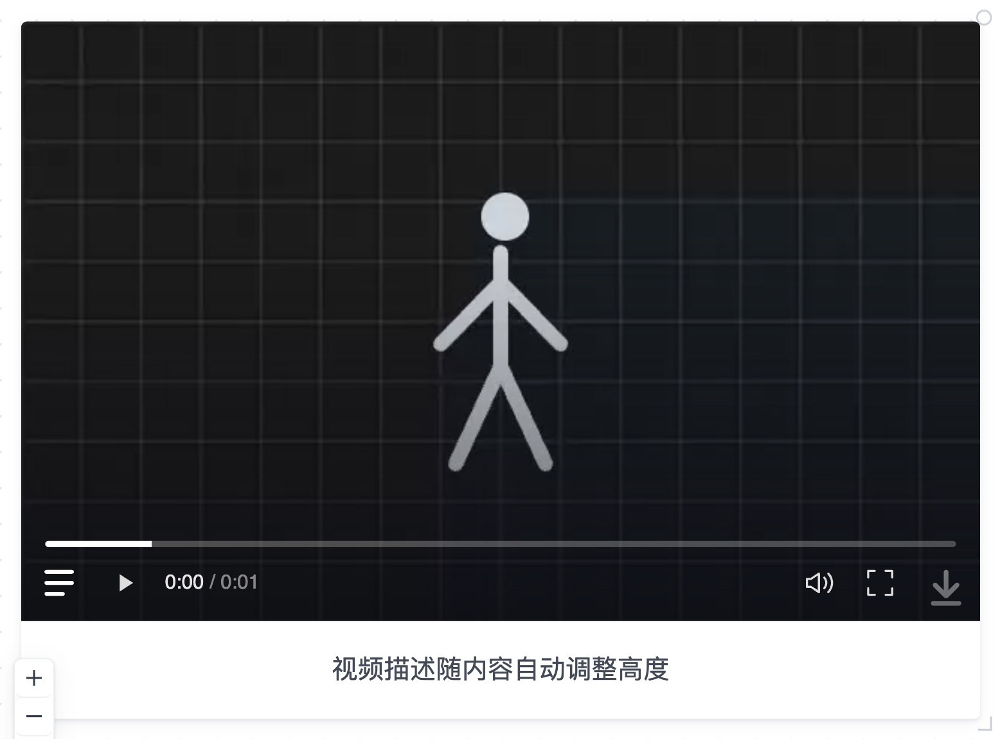

# FlowTracker

项目：[foursheepliu/FlowTracker](https://github.com/foursheepliu/FlowTracker)。这里记录界面偏好与修改过程，不复制整个应用仓库。

## 视频卡片

- [当前决定](decisions/2026-11-05-video-player.md)
- [修改前、修改后和中间版本](history/2026-11-04--05-video-player.md)
- [选中后空格播放的实现说明](implementation/keyboard-playback.md)
- [截图来源](assets/video-player/manifest.json)

当前实现：无中央播放按钮；单选视频后空格播放/暂停；描述从媒体内左下角图标展开，白色区域与视频相连、等宽，文字居中，无占位词；右下角缩放柄为轻量角标。

本轮要求已实现并做行为验证，尚未把它记为用户最终验收。之后的反馈继续追加到 history，并更新当前决定。

截图用独立视频样例采集，内容不是用户研究项目的真实视频或笔记。旧版截图仅比较 UI；当时的附件读取缺陷另有记录，不能用这组图证明原版本可正常播放。
