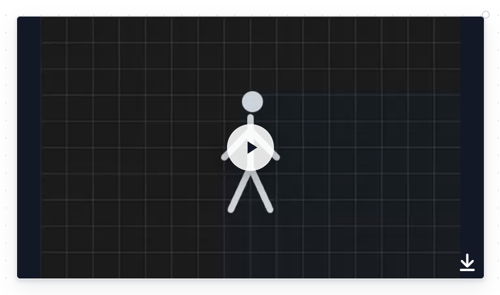
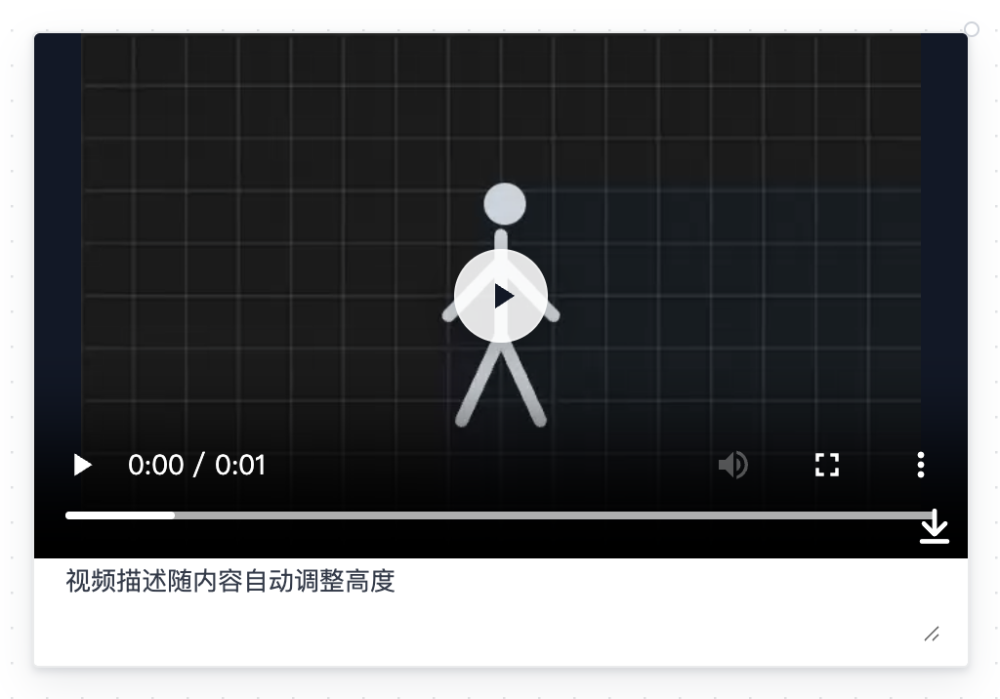
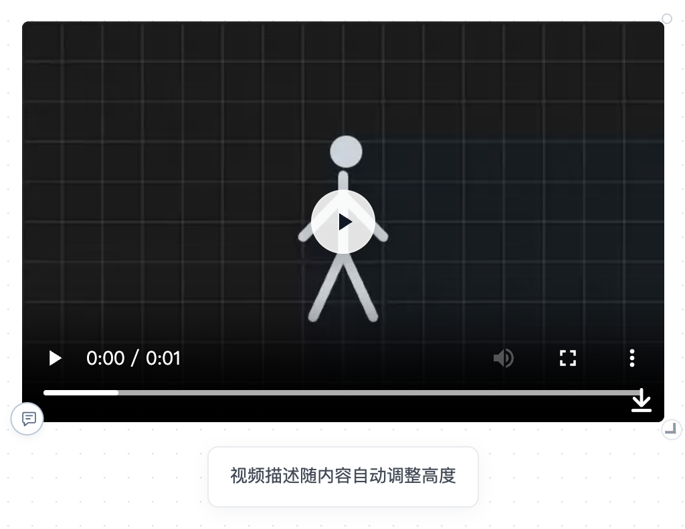
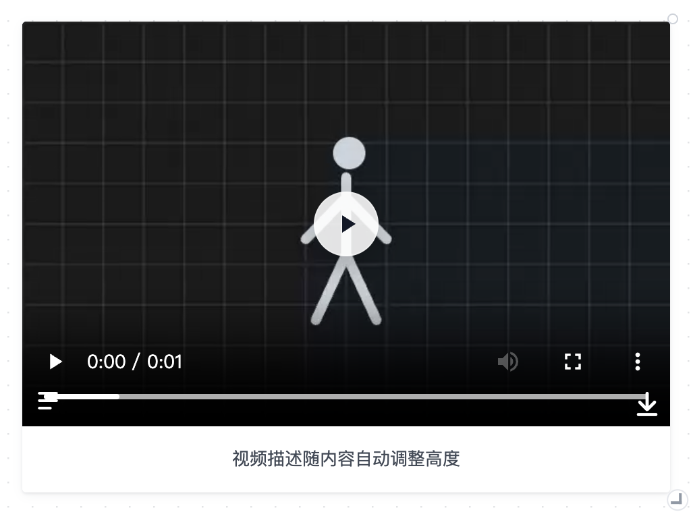
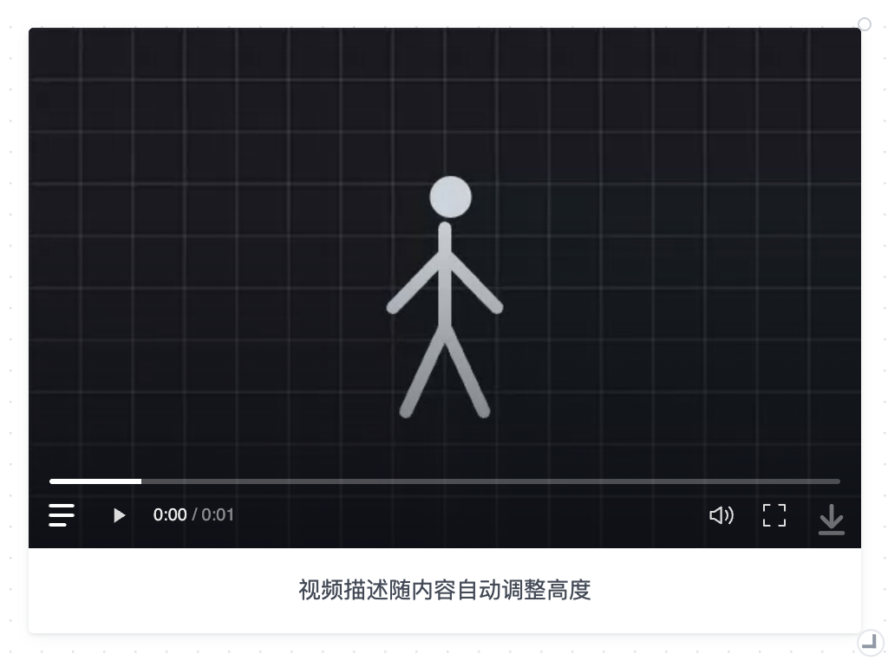
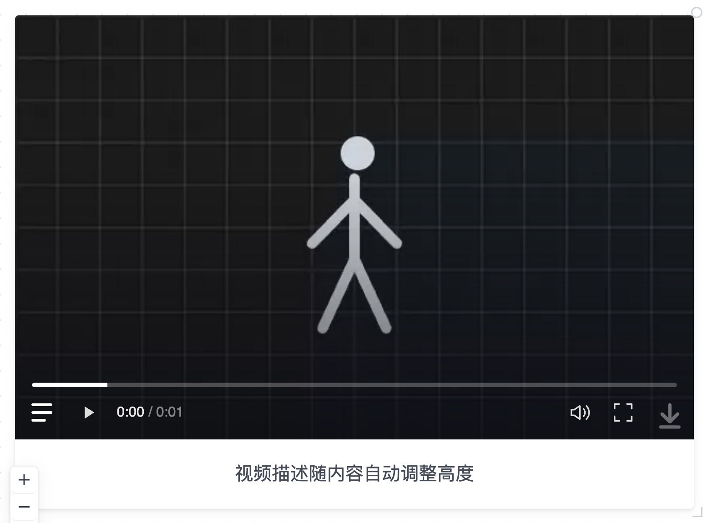
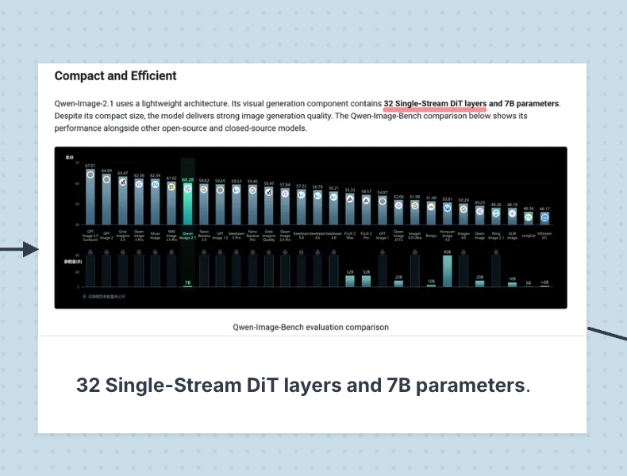

# 视频播放器的修改过程

这次从“视频无法加载、播放、添加描述”开始，之后连续调整描述和播放器样式。下面保留明显改版及用户纠正的原因。

所有配图均使用同一个独立生成的视频样例，在保留的本地构建上重新采集。文字和媒体内容是样例；采集环境统一提供资源读取，目的是比较 UI，不能据此认定历史版本的媒体加载已经正常。

## 00 · 修改前：浏览器默认播放器

日期：2026-11-04。状态：已替代。

视频框被固定为 16:9，没有可编辑的视频描述。文档导入还把视频当普通附件，本地协议缺少媒体流配置。初次修复后还出现了新界面配旧后台的情况，完整重启后才恢复播放。

## 01 · 常驻描述输入框

日期：2026-11-04。状态：用户否定。

补齐视频读取、播放、描述保存后，直接在视频下方放了常驻 textarea。

用户反馈：“这个描述框也太丑了吧，直挺挺的显示在下面？”并希望通过左下角入口展开、收起，文字居中。

## 02 · 浮动描述气泡

日期：2026-11-04。状态：用户明确否定。

将描述做成与视频分离、带圆角阴影的浮动气泡，左下角入口也加了圆形白底。视频开始按原始比例显示。

用户纠正：“点击后是直接往下加一个白色的框，这个悬浮框好丑”，并提供了 Milanote 的相连卡片作为参考。

这版说明：需要按需展开，不等于需要浮层。

## 03 · 与视频相连的描述区

日期：2026-11-04。状态：结构保留，图标样式继续修改。

描述区回到卡片的正常布局，直接连接视频底边，等宽、白底，文字居中。入口移入视频内部，做成线条图标。

但描述入口继承了全局 button:hover 背景，悬停时出现方形底框。用户要求模仿已有下载箭头的变化。

## 04 · 去掉图标悬停底框

日期：2026-11-04。状态：保留。

覆盖描述按钮继承的背景与边框，沿用下载箭头的淡入、轻微位移效果。

## 05 · 轻量播放器

日期：2026-11-05。状态：部分保留，中央播放按钮被替代。

删除“添加视频描述…”占位文字。浏览器原生控制栏改成细进度条、轻量时间与静音/全屏按钮，悬停显现。当时还保留了中央半透明播放按钮和带圆底的缩放柄。

## 06 · 本轮：选中后用空格播放

日期：2026-11-05。状态：已实现，等待后续使用反馈。

用户要求：“中间的播放按钮删掉，通过选中后的空格键来播放和暂停就好。”随后指出右下角控件与其他角的大小不协调。

本轮删除中央覆盖按钮，给单独选中的视频分配空格播放/暂停，描述编辑不受影响。缩放柄移除突出圆底，恢复为小角标。底部的轻量操作和相连描述区继续保留。

## 以后继续修改

新增一版时追加到这份记录或建立新的日期记录，保留旧图和被否定的原因。更新当前决定与偏好配置，不直接覆盖中间版本。

## 用户指定的视觉参考

用户在否定浮动气泡时提供的 Milanote 截图。关注的是媒体下方直接相连的白色描述区、统一宽度和居中排版；截图中的技术内容不是本项目的需求。

