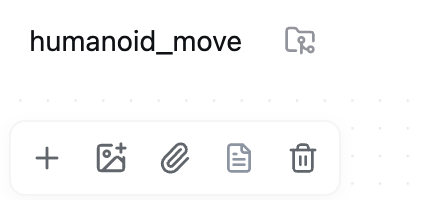
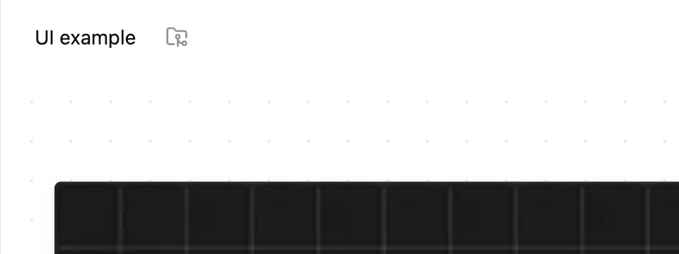

# 去掉画板标题下方的工具栏

日期：2026-11-05。状态：用户明确要求，已实现，等待使用反馈。

用户指着标题下方的一排图标说：“把这里的下方几个小图标都去掉，没什么用”。本次只针对这排浮动工具栏，不扩展为所有软件都不需要工具栏。

## 修改前

这排工具栏包含新建文字、插入图片、插入附件、引用文档和删除选中块。

## 修改后

整排工具栏从画板移除，标题下方恢复为空白画布。清理了只用于这排入口的图标导入、引用搜索状态和按钮回调。画板本身及拖入文件、文档块和笔记引用的处理保留。

修改后截图使用隔离样例项目，显示的是同一位置的布局变化；不是用户真实项目的截图。

## 验证

TypeScript 与构建检查；文档块、图片拖入及跨项目引用的既有集成检查通过。跨项目引用的测试入口改为拖入笔记，不再依赖已删除的引用按钮。
